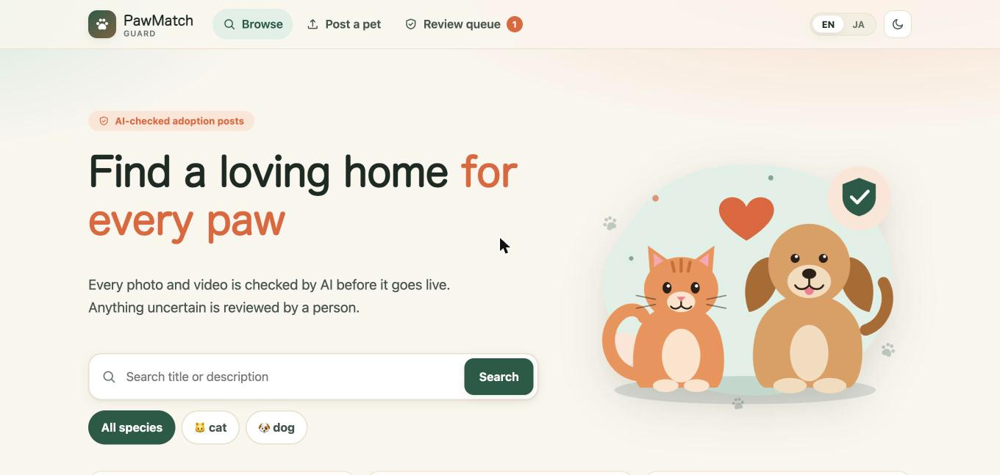
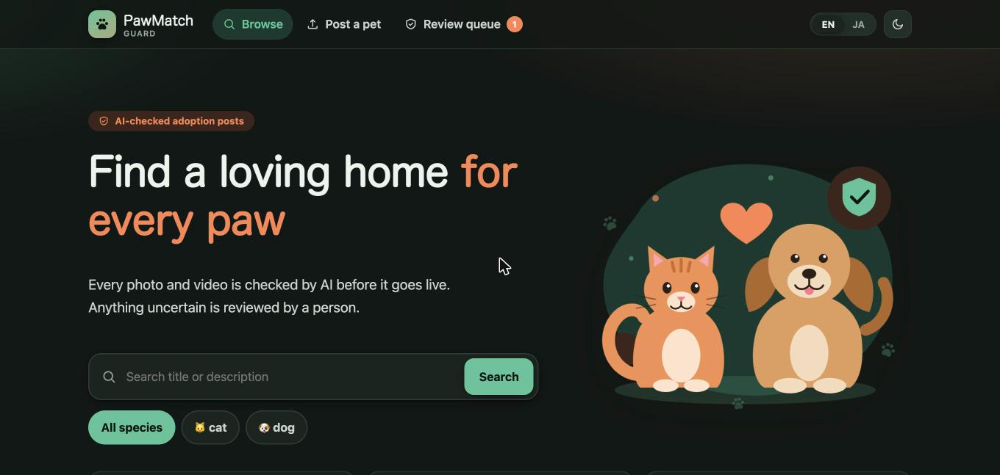
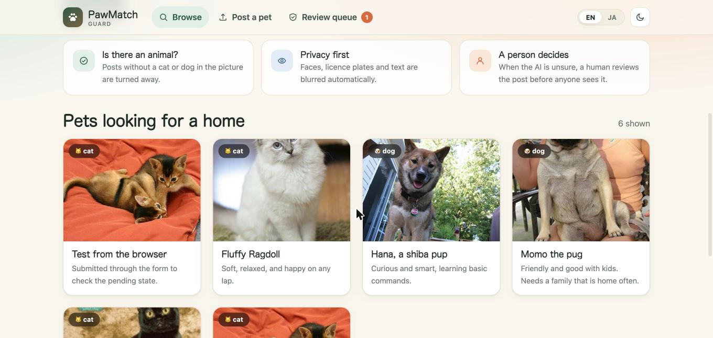
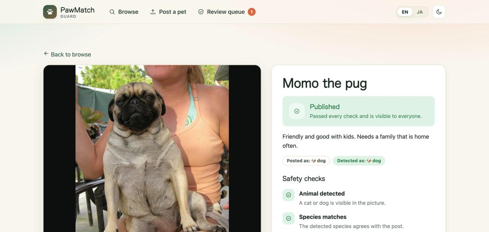
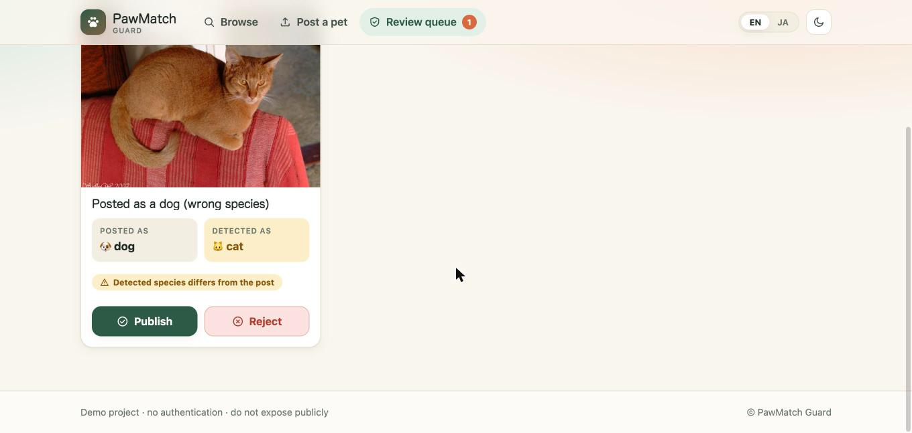
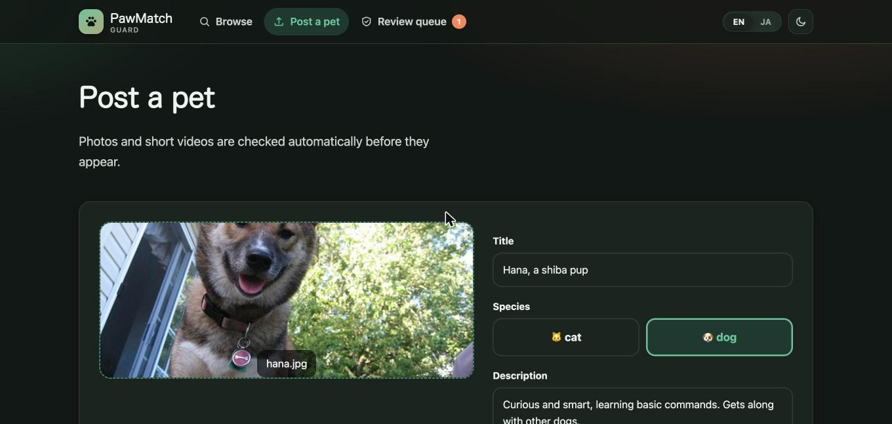
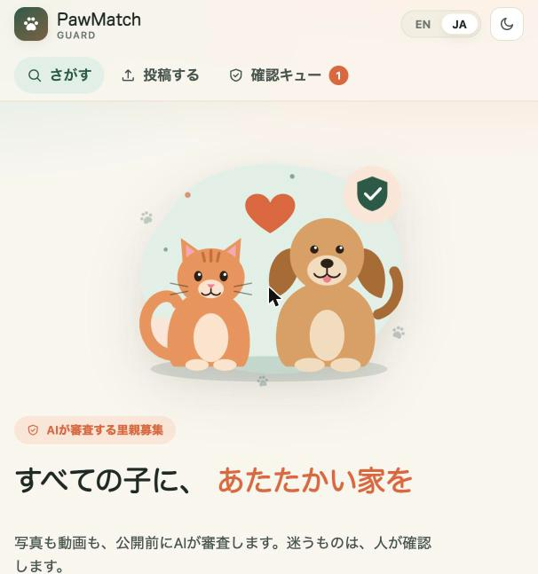

# PawMatch Guard

🇬🇧 English | [🇯🇵 日本語](README.ja.md)

A pet-adoption matching app with an **AI moderation pipeline** for user posts. Matching is kept light; the showcase is the image/video review pipeline: classification, detection and segmentation models decide *publish / needs review / reject*, and anything uncertain goes to a human.


> Status: **Phases 1–3 implemented** (classification, segmentation, detection, annotation QA, moderation pipeline, web app). **Phase 4 is partial**: ONNX/quantization benchmark done; the AWS design is written and validated but **not deployed**. Face / plate / text detection is not trained yet. See *Results* and the known limitations below.

## Screenshots

<p align="center">
  
  
</p>

| | |
|---|---|
|  |  |
| Browse: published posts as cards | Post detail with the safety checks |
|  |  |
| Review queue: the AI's doubt next to the poster's claim | Post a pet: drag-and-drop preview (dark theme) |

<p align="center"><br><sub>Narrow screen, Japanese UI</sub></p>

Captured from the running app (`uv run pawmatch serve`) with a few sample posts made from the Oxford-IIIT Pet photos (CC BY-SA 4.0). The hero illustration is original artwork for this project (MIT).

## Features (Phase 1)

- Breed-stratified 70/15/15 split of Oxford-IIIT Pet, fixed seed, duplicate check by content hash, split saved as CSV
- ResNet50 transfer learning with two heads: species (cat/dog) and 37 breeds
- Class-imbalance options: weighted CE, `WeightedRandomSampler`, Focal Loss
- Metrics implemented from scratch (confusion matrix, accuracy, per-class P/R/F1, macro-F1) and tested against scikit-learn
- Config-driven runs saved to `runs/<timestamp>/` (config, metrics, weights)
- English (default) / Japanese UI for CLI output via `--lang` or `PAWMATCH_LANG`

## Quick start

Requires [uv](https://docs.astral.sh/uv/) (Python 3.12 is installed automatically).

```bash
uv sync
uv run pawmatch prepare-data          # download dataset (~800 MB) + create data/splits/*.csv
# official server can be very slow outside the UK; use the Hugging Face mirror instead:
uv run pawmatch prepare-data --source hf
uv run pawmatch train                 # uses configs/classification.yaml
uv run pawmatch report runs/<run_dir> # print test metrics
uv run pawmatch train-seg             # segmentation (configs/segmentation.yaml)
uv run pawmatch train-det             # animal-head detector (configs/detection.yaml)
uv run pawmatch detect-noise runs/<run_dir>  # 5% label-noise experiment
uv run pawmatch evaluate-moderation   # whole-pipeline confusion matrix
uv run pawmatch serve                 # demo web app (no authentication)
```

Japanese output: `PAWMATCH_LANG=ja uv run pawmatch train` or `uv run pawmatch --lang ja train`.

The AWS code path locally (S3 → SeaweedFS, DynamoDB → DynamoDB Local): `docker compose --profile aws-local up`.

With Docker (CPU, no GPU needed):

```bash
docker compose run --rm prepare
docker compose run --rm train
```

Quality checks: `uv run ruff check . && uv run pytest`

## Layout

```
src/data        download, split, preprocessing
src/models      classifier, training
src/metrics     from-scratch metrics
src/i18n        en / ja messages
src/quality     annotation checks, agreement, noisy-label detection
src/moderation  rules, blur, video (ffmpeg), pipeline, evaluation
src/api         FastAPI app (posts, search, review queue)
configs/        experiment YAMLs
docs/           debugging log, annotation guidelines
infra/          Terraform (S3, Lambda, DynamoDB, ECR, Budgets); not applied
```

## Moderation rules (implemented in `src/moderation/rules.py`)

1. No animal detected → **reject**
2. Face / license plate / text detected → auto-blur, then **publish**; low confidence → **needs review**
3. Classification disagrees with the post (e.g. "cat" but model says dog) → **needs review**
4. Otherwise → **publish**

## Results

### Phase 1: classification (test split, 1,104 images, ResNet50, 8 epochs, seed 42, CE loss, no resampling)

| Task | Accuracy | macro-F1 |
|---|---|---|
| Species (cat / dog) | 0.9955 | 0.9948 |
| Breed (37 classes) | 0.9076 | 0.9070 |

Species confusion matrix (rows = true, columns = predicted):

| | pred cat | pred dog |
|---|---|---|
| **true cat** | 353 | 2 |
| **true dog** | 3 | 746 |

Weakest breeds (F1): staffordshire_bull_terrier 0.71, beagle 0.79, american_pit_bull_terrier 0.80, ragdoll 0.82, american_bulldog 0.82.
Most frequent confusions: ragdoll→birman (8), newfoundland→leonberger (5), british_shorthair→russian_blue (5), basset_hound→beagle (4), staffordshire_bull_terrier→american_bulldog (4). These are visually similar pairs.

Full per-class metrics and the 37×37 confusion matrix: [`docs/results/phase1_metrics.json`](docs/results/phase1_metrics.json); config: [`docs/results/phase1_config.yaml`](docs/results/phase1_config.yaml).
Caveats: single run, single seed; validation accuracy plateaued around 0.90 from epoch 4 and was noisy (0.896–0.923), so differences of ~1 point are not meaningful. Imbalance options (weighted CE / sampler / Focal) are implemented but not yet compared.

### Phase 2 (in progress): segmentation, annotation QA

**Segmentation** (DeepLabV3-MobileNetV3, 256 px, 4 epochs, full train split, test = 1,104 images, own metrics):

| IoU | Dice | Boundary IoU |
|---|---|---|
| 0.897 | 0.943 | 0.290 |

Boundary IoU is much lower than IoU because the Oxford trimap's "boundary" class is an uncertain band around the fur edge; the metric measures a 3 px contour band at 256 px, so it is a strict edge-quality indicator, not a defect. Config/metrics: [`docs/results/phase2_seg_full_metrics.json`](docs/results/phase2_seg_full_metrics.json).

**Noisy-label detection** (5 % of breed labels swapped on val+test, 2,206 images, 110 noisy; classifier from Phase 1, which never trained on these images):

| Method | Flagged | Caught | Recall | Precision |
|---|---|---|---|---|
| Top 5 % by loss of the given label | 110 | 101 | 0.918 | 0.918 |
| Any prediction ≠ label | 285 | 110 | 1.000 | 0.386 |

The model itself is wrong on 8.5 % of clean labels, which is why "disagree" flags so many. Details: [`docs/results/noise_detection.json`](docs/results/noise_detection.json). Single seed.

**Preprocessing-bug experiments:** see [`docs/debugging.md`](docs/debugging.md). Main finding: three injected bugs moved IoU by only 0.1–1.7 pt (within plausible noise); the mask-resize bug showed up as a 34 % drop in *boundary* IoU.

**Object detection** (Faster R-CNN MobileNetV3-FPN, COCO-pretrained, 3 epochs, one class `animal_head`, test = 571 images with boxes, own metrics):

| AP@0.5 | mAP@0.5:0.95 | Recall@IoU0.5 | Images with a detection (score ≥ 0.5) |
|---|---|---|---|
| 0.988 | 0.723 | 0.993 | 0.991 |

Caveats: (1) Oxford's boxes cover the animal's **head** only and only ~3.7k images have them (train 2,551 / val 549 / test 571), so this is a head detector used as a proxy for "an animal is visible". (2) Every test image contains a pet, so the numbers say nothing about false positives on photos *without* animals, which matters for moderation rule 1 ("no animal → reject"); that needs negative images. (3) The photos are pet-centred, so AP@0.5 is near its ceiling; mAP@0.5:0.95 (0.72) is the more informative number. (4) Face / plate / text classes need the custom Label Studio annotations and are not trained yet. Single run. Files: [`docs/results/phase2_det_metrics.json`](docs/results/phase2_det_metrics.json).

**Not done yet in Phase 2:** the custom face/plate/text annotations in Label Studio and the detector classes that depend on them. The metric code (IoU, AP@0.5, mAP@0.5:0.95, per-class recall) matches torchmetrics/pycocotools.

### Phase 3: moderation pipeline and app

End-to-end evaluation on the Phase 1 **test split** (1,104 pet photos, each submitted twice: once with the correct species and once with the wrong one; 2,208 cases; classifier + animal-head detector + rules; `uv run pawmatch evaluate-moderation`):

| Case (expected verdict) | Publish | Needs review | Reject | n |
|---|---|---|---|---|
| Correct species (publish) | 1,089 | 12 | 3 | 1,104 |
| Wrong species (needs review) | **4** | 1,097 | 3 | 1,104 |
| **No animal (reject)** | **31** | 81 | 188 | 300 |

- Misses (a wrong-species post published): 4 of 1,104. Unnecessary reviews: 12 of 1,104 (1.1 %). Valid posts wrongly rejected: 3 of 1,104 (the detector found no head).
- The 50 % "human review rate" in the JSON is **an artefact of the test design** (half the cases are deliberately wrong); on real traffic it would be much lower.
- **Posts without any animal (rule 1) — a real weakness.** On 300 Open Images CC BY 2.0 photos with no animal label (`scripts/build_negatives.py`; 48 random ones plus all 31 published ones were checked by eye and show no animal): **188 rejected (62.7 %), 81 sent to review (27.0 %), 31 published (10.3 %)**. The animal-head detector was trained on pet photos only, never on negatives, so it fires on human faces/heads (score 0.6–0.96) and sometimes on food or objects (0.5–0.8). Raising the animal threshold does not fix it without costing pet recall: at 0.9, 4.3 % of the negatives still pass while 3.0 % of pet photos would no longer count as animals ([`docs/results/negatives_score_analysis.json`](docs/results/negatives_score_analysis.json)). The remedy is to train the detector with negatives (people included), which is not done yet. Caveats: a missing Open Images label is not proof of no animal (see the spot checks), and 300 images is a small sample.
- Test photos are clean pet portraits and the species classifier is 99.5 % accurate on them, so these numbers are optimistic for messy user uploads. Thresholds in `configs/moderation.yaml` were not tuned on a validation set.

**Detector retrained with negatives.** The 300 negatives were split 150 / 150 (`data/splits/negatives_split.csv`, seed 42). The detector was retrained on the pet photos plus the 150 *train* negatives (as all-background images, repeated ×3; `configs/detection_neg.yaml`), then both detectors were evaluated on the other 150 negatives, which neither had seen, with the same pipeline and thresholds (`--negatives-split`):

| Detector | No animal → reject | review | **publish (miss)** | Pet photos wrongly rejected | Wrong-species posts published |
|---|---|---|---|---|---|
| Pets only (before) | 91 (60.7 %) | 44 | **15 (10.0 %)** | 3 / 1,104 | 4 / 1,104 |
| + negatives (after) | 116 (77.3 %) | 25 | **9 (6.0 %)** | 2 / 1,104 | 4 / 1,104 |

On the pet test set the new detector is at least as good (AP@0.5 0.989, mAP@0.5:0.95 0.742 vs 0.988 / 0.723; [`docs/results/phase3_det_neg_metrics.json`](docs/results/phase3_det_neg_metrics.json)). So training with negatives helped, but **6 % of no-animal photos are still published**, which is too many for a moderation system that should not miss. With only 150 test images the two miss rates (10.0 % vs 6.0 %) differ by about 4 points with a sampling uncertainty of roughly ±4–5 points each, so the improvement is real in direction but not precisely measured. Next steps would be many more negatives (people, food, objects), hard-negative mining, and keeping a larger held-out set. Use `configs/pipeline_neg.yaml` for the improved detector; `configs/pipeline.yaml` (pets-only detector) reproduces the table above. Raw results: [`moderation_eval_heldout_old.json`](docs/results/moderation_eval_heldout_old.json), [`moderation_eval_heldout_new.json`](docs/results/moderation_eval_heldout_new.json).

**Known limitations (important):**
- Face / licence-plate / text detection is **not trained**, so the PII blur path is implemented and unit-tested with fakes but never triggers with the real models.
- Videos are screened frame by frame (1 fps, worst frame wins) but the video file itself is not blurred, so any video with detected personal information is sent to review rather than published.
- The web app has **no authentication** (demo only); the review queue is open. Do not expose it publicly.
- Video extraction needs a working `ffmpeg`. The Homebrew build on the development machine is broken (missing `libvpx`), so the unit test is skipped there; inside the Docker image (which installs ffmpeg) a synthetic 3-second clip was split into 3 frames. A real user video through the whole pipeline and the web app has not been tested.
- Matching is intentionally light: filter by species (taken from the classifier) and search title/description.

Run the app: `uv run pawmatch serve` then open http://127.0.0.1:8000 (`?lang=ja` for Japanese). Point `configs/pipeline.yaml` at your trained runs first (weights are not in Git).

### Phase 4 (partial): ONNX export, quantization, CPU speed

Species+breed classifier (ResNet50), CPU only, per-image latency p50 / p95 in ms (40 runs after 5 warm-up), accuracy on the first 400 test images. Measured on **Apple M1 (8 cores)**, torch 2.15.0, onnxruntime 1.32.0; this is *not* an AWS CPU.

| Variant | Input | Batch 1 (ms) | Batch 8 (ms/img) | Breed acc | Species acc | Agrees with PyTorch |
|---|---|---|---|---|---|---|
| pytorch_fp32 | 224 | 24.3 / 34.1 | 24.7 / 26.1 | 0.895 | 0.995 | 1.000 |
| onnx_fp32 | 224 | 52.7 / 81.9 | 52.6 / 65.5 | 0.895 | 0.995 | 1.000 |
| onnx_int8_dynamic | 224 | 26.5 / 34.1 | 27.0 / 29.3 | 0.885 | 0.998 | 0.965 |
| pytorch_fp32 | 160 | 15.9 / 21.0 | 13.2 / 17.1 | 0.900 | 0.995 | 1.000 |
| onnx_fp32 | 160 | 32.5 / 47.9 | 32.6 / 49.8 | 0.900 | 0.995 | 1.000 |
| onnx_int8_dynamic | 160 | 17.2 / 20.2 | 16.3 / 18.4 | 0.880 | 0.990 | 0.950 |

Model size: ONNX fp32 94 MB, dynamic INT8 24 MB.

What the table shows (single machine, one run, n=400 so accuracy has roughly ±1.5 pt of sampling noise):
- **ONNX Runtime fp32 was about 2× *slower* than PyTorch on this Mac** (≈52 vs ≈24 ms). Changing thread count and graph-optimization level did not change that (46–57 ms), so I report it as measured rather than as a speed-up. Whether it holds on x86 (e.g. AWS) is not measured.
- Dynamic INT8 matched PyTorch's speed (≈26 ms) at one quarter of the size, at a cost of about 1 pt breed accuracy (0.885 vs 0.895) and 96.5 % prediction agreement.
- 160 px input is about 35 % faster than 224 px with no measurable accuracy loss at this sample size; the model was trained at 224 px, so check on a larger set before adopting it.
- Batch size barely changed per-image latency on CPU.

Not done: ONNX export of the detector (Faster R-CNN) and segmentation model; AWS infrastructure. Raw numbers: [`docs/results/onnx_benchmark.json`](docs/results/onnx_benchmark.json). Reproduce: `uv run pawmatch benchmark runs/<classifier_run>`.

### Phase 4 (partial): AWS design and cost

Design (details and diagram: [`docs/architecture.md`](docs/architecture.md); code: [`infra/terraform`](infra/terraform), [`src/aws_lambda.py`](src/aws_lambda.py)): S3 upload → **one container Lambda** moderates the post → result in **DynamoDB**; after a model update an operator invokes the same Lambda with `{"action": "reevaluate"}`, which re-checks live posts 20 at a time and chains itself. Re-evaluation only ever tightens a verdict and never touches posts a person decided.

**Cost.** *Nothing has been deployed to AWS and no AWS cost has been incurred; nothing in this repo creates AWS resources unless you run `terraform apply` yourself.* The design was changed to stay inside the free tier: ECS/Fargate and Batch were dropped (Fargate has no free tier I could find; Batch only adds Fargate/EC2 charges), DynamoDB uses provisioned capacity (on-demand tables get no free capacity units), and an AWS Budgets alert is included. Terms below come from AWS's pages and third-party guides and must be re-checked before deploying.

| Service | Use | Free tier | Expected cost |
|---|---|---|---|
| Lambda | moderation + re-evaluation | always free: 1M requests, 400,000 GB-s / month | $0 at portfolio traffic (see timings) |
| DynamoDB | posts | always free: 25 GB, 25 provisioned WCU/RCU | $0 (uses 10 + 10 of 25) |
| S3 | uploads, outputs, weights | free allowance depends on account type; **not verified** | cents or less |
| CloudWatch Logs | 7-day retention | allowance **not verified** | cents or less |
| ECR | one Lambda image, ≈0.6 GB compressed | 500 MB free for the first 12 months only | **not free**: ≈ $0.01–0.07 / month |
| AWS Budgets | $1 monthly alert | first budgets free | $0 |

So the honest answer is "about zero, not exactly zero": the container image in ECR is the one item that is not covered (ECR is required for Lambda container images, and PyTorch does not fit a zip package).

Measured locally (Lambda runtime emulator, Docker on Apple M1, arm64 image; **not** measured on AWS): cold start with weight download from S3 ≈ 11.4 s for 2 posts; warm ≈ 0.26 s per post; a duplicate S3 event ≈ 30 ms. At 3 GB, 400,000 GB-s is on the order of 10,000 posts/month if every post were a cold start and far more when warm; real numbers need a deployment to measure.

Verified: `terraform validate` and `fmt` pass (this checks syntax and schema only, not that `apply` would succeed or that IAM is sufficient); the Lambda image builds (1.78 GB, CPU-only PyTorch), loads weights from an S3-compatible store, moderates posts and writes to DynamoDB Local when invoked through the Lambda runtime emulator; the web app runs the full flow against SeaweedFS + DynamoDB Local; stores are contract-tested against moto. **Not verified:** a real `terraform apply`, the S3 → Lambda event wiring, the Lambda's self-invocation (unit-tested with a fake client only), and real AWS performance.

Known gaps: the Lambda image has no `ffmpeg`, so **video posts would end in `error` on AWS** (they work locally and in the Docker image); the FastAPI app is not part of the Terraform stack; ONNX export is done for the classifier only (and ONNX Runtime was slower than PyTorch on the Mac, see above), so the Lambda uses PyTorch.

## Roadmap

1. Classification & evaluation foundation ✅ (code), results below
2. Segmentation ✅, annotation QA ✅ (guidelines, checks, noise detection), debugging log ✅; animal-head detector ✅; Label Studio annotation of face/plate/text pending
3. Moderation pipeline ✅, FastAPI app ✅, video frame extraction verified in Docker on a synthetic clip only; negative-photo evaluation done: 10.3 % of no-animal photos still pass (detector needs negative training)
4. ONNX + quantization ✅ (classifier). AWS: free-tier design written, validated and exercised locally; **not deployed** (S3 → Lambda → DynamoDB; re-evaluation by chained Lambda)

## Data & license

Oxford-IIIT Pet is licensed CC BY-SA 4.0. Only split CSVs and hashes are committed; images are not.

The 300 negative photos come from [Open Images](https://github.com/openimages/dataset) (images CC BY 2.0 per-image metadata, annotations CC BY 4.0). They are not committed; [`data/negatives_manifest.csv`](data/negatives_manifest.csv) lists each image's author, title and source for attribution, and `scripts/build_negatives.py` rebuilds the set.

## License

The source code is released under the [MIT License](LICENSE). The hero illustration is original to this project and covered by the same license.

Datasets and images are **not** covered by it and keep their own licenses: Oxford-IIIT Pet (CC BY-SA 4.0) and the Open Images negatives (CC BY 2.0 images, CC BY 4.0 annotations; attribution in [`data/negatives_manifest.csv`](data/negatives_manifest.csv)). Trained weights are derived from those datasets and are not distributed here; check the dataset terms before sharing them. Third-party Python packages keep their own licenses.
