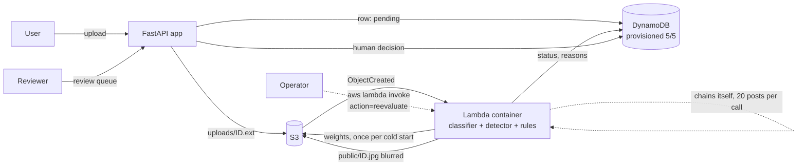

# Architecture / 構成

- **Only published posts are shown.** `review` posts wait for a person; `rejected` and `error`
  are hidden. 公開可のものだけが表示され、要確認は人の判断待ち。
- **Re-evaluation only tightens.** After a model update, published → review/rejected is
  allowed; nothing is ever loosened, and posts a person decided are never touched.
  再評価は厳しくする方向のみ。人が判断した投稿には触れない。
- **No always-on compute.** Nothing runs between uploads (no ECS service, no Batch fleet).
  アップロードがないとき、動いているものはありません。
- **Local equivalents** (`docker compose --profile aws-local`): S3 → SeaweedFS, DynamoDB →
  DynamoDB Local, Lambda → the same handler code. MinIO's official images can no longer be
  pulled, hence SeaweedFS.

The FastAPI app itself is *not* deployed by `infra/terraform`; run it anywhere with
`PAWMATCH_STORAGE=aws PAWMATCH_MODERATION=external` and the table/bucket names from the
Terraform outputs. アプリ本体は Terraform の対象外です。
